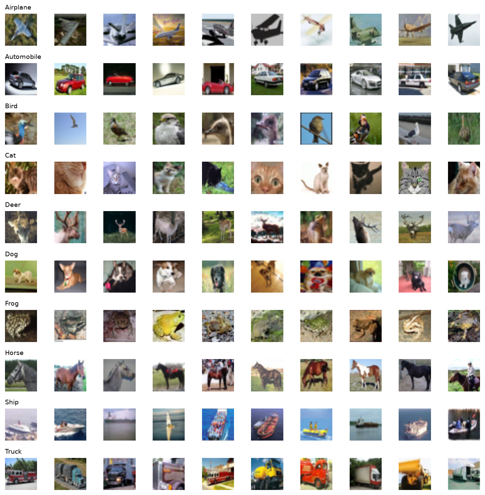
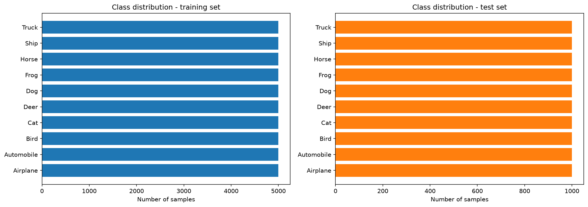
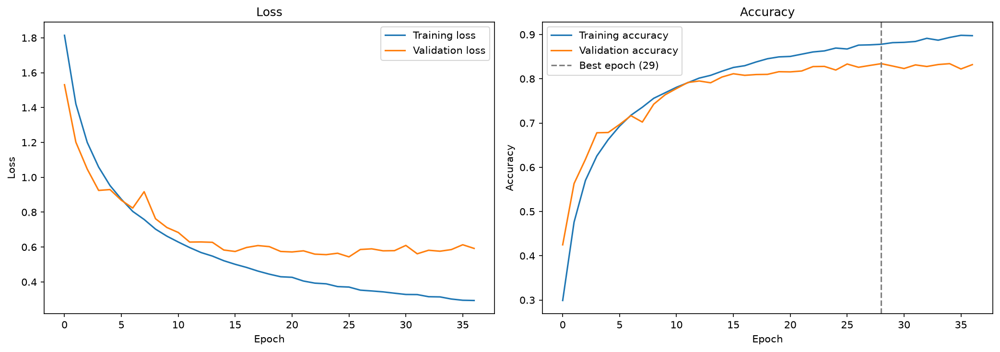
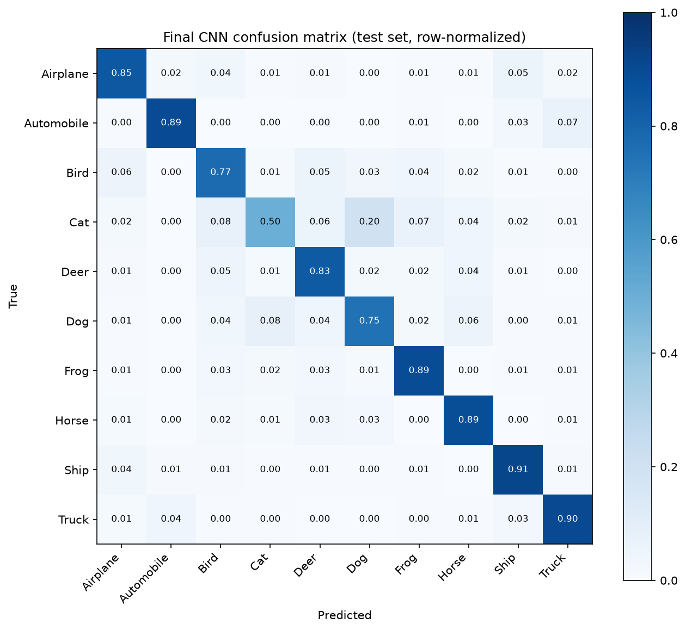

# CIFAR-10 Image Classification: MLP vs CNN (Keras)

This project teaches a computer to recognize small pictures of 10 kinds of objects (airplane, car, bird, cat, and more).
I build two models and compare them:

- an **MLP**, which is a simple neural network, and
- a **CNN**, which is a neural network designed for images.

**Main result:** the tuned CNN gets **81.76%** of the test images right. The MLP gets only **43.69%**.

---

## Results at a glance

| Model | Test accuracy | Error rate |
|---|---|---|
| MLP | 43.69% | 56.31% |
| CNN (first version, before tuning) | 76.09% | 23.91% |
| **CNN (tuned)** | **81.76%** | **18.24%** |

- *Accuracy* is the share of test images that the model labels correctly.
- All three numbers come from the same 10,000 test images, which the models never saw during training or tuning.
- The CNN makes about 3 times fewer mistakes than the MLP (18.24% against 56.31%).
- Tuning the CNN added about 5.7 percentage points (81.76% against 76.09%).

---

## The data

[CIFAR-10](https://www.cs.toronto.edu/~kriz/cifar.html) has 60,000 colour pictures, each only 32 x 32 pixels, in 10 classes:
airplane, automobile, bird, cat, deer, dog, frog, horse, ship and truck.

| Part | Images | Used for |
|---|---|---|
| Training | 45,000 | teaching the model |
| Validation | 5,000 | comparing settings while tuning |
| Test | 10,000 | the final grade, used once |

The classes are balanced: the test set has exactly 1,000 images of each class. This is why plain accuracy is a fair way to score the models.





---

## The models

### 1. MLP (notebook: `CIFAR10-mlp.ipynb`)

An MLP does not look at a picture as a picture. It flattens the 32 x 32 x 3 image into one long list of 3,072 numbers and learns from that list.
Because of this, it loses the information about which pixels are neighbours.

- Layers: 3072 inputs, then 512, 256 and 128 neurons, then 10 outputs (one per class)
- Dropout 0.3 after the first two hidden layers
- Adam optimizer (learning rate 0.001), batch size 64, 70 epochs

### 2. CNN (notebook: `CIFAR10-cnn.ipynb`)

A CNN keeps the picture as a picture. Small filters slide over the image and find edges, shapes and textures. This is why it works much better for images.

**Final CNN (after tuning):**

- 4 blocks of convolution layers. Each block has 2 convolution layers (3 x 3 filters) and one max-pooling layer.
- The blocks use 32, 64, 128 and 256 filters.
- Then one dense layer with 128 neurons and 10 outputs.
- Dropout 0.3 after every block and after the dense layer.
- Adam optimizer (learning rate 0.0005), batch size 64.
- Early stopping: training stops when the validation accuracy has not improved for 8 epochs, and the best weights are restored.
- It has 1,304,746 parameters. Training stopped at epoch 37 and the best epoch was 29.

**First version of the CNN (the baseline):** 3 convolution layers, 242,122 parameters, batch size 64, 30 epochs.

---

## Final CNN: training and mistakes



The left plot shows the loss (lower is better), the right plot shows the accuracy (higher is better).
The training accuracy ends near 0.90 and the validation accuracy near 0.83. The gap is small enough that I call the overfitting "mild". Dropout and early stopping keep it under control.



Each row of the confusion matrix is the true class and each column is the predicted class. A strong diagonal means most images are labelled correctly.

### Which classes are easy and which are hard?

Share of the test images of each class that the model found correctly:

| Class | MLP | Final CNN |
|---|---|---|
| Airplane | 43.2% | 84.6% |
| Automobile | 50.7% | 89.1% |
| Bird | 7.1% | 77.0% |
| Cat | 49.3% | 49.9% |
| Deer | 39.4% | 83.5% |
| Dog | 12.6% | 74.8% |
| Frog | 66.7% | 88.9% |
| Horse | 49.6% | 88.5% |
| Ship | 52.7% | 91.4% |
| Truck | 65.6% | 89.9% |

- The CNN is best on **ships, trucks, cars, frogs and horses** (all near 89% to 91%).
- **Cats are the hardest class.** The CNN finds only about half of them, and about 20% of all cats are labelled as dogs. Only about 8% of dogs are labelled as cats, so the model leans towards "dog".
- Among vehicles, about 7% of cars are labelled as trucks, and airplanes and ships are sometimes mixed up.
- The MLP's cat score looks similar to the CNN's, but only because the MLP guesses "cat" very often. Only 25.9% of its "cat" guesses are correct. It almost never finds birds (7.1%) and dogs (12.6%).

---

## Project structure

```text
CIFAR10-MLP-CNN/
├── notebooks/
│   ├── CIFAR10-mlp.ipynb      # MLP model
│   └── CIFAR10-cnn.ipynb      # CNN model and tuning
├── reports/
│   ├── figures/               # pictures used in this README
│   ├── tuning_*.csv           # tuning results
│   └── results_cnn.json       # final CNN numbers
├── data/                      # created automatically, not stored in git
├── models/                    # saved models, not stored in git
├── requirements.txt
└── README.md
```
---

## Run it yourself

---- Run with GPU ----

```bash
git clone https://github.com/isapour0/CIFAR10-MLP-CNN.git
cd CIFAR10-MLP-CNN

python -m venv .venv
source .venv/bin/activate          # on Windows: .venv\Scripts\activate
pip install -r requirements.txt

jupyter lab
```

---
## Author

AliAkbar Isapour
[GitHub](https://github.com/isapour0) | [LinkedIn](https://www.linkedin.com/in/aliakbar-isapour-682592413)

## References

- Krizhevsky, A. (2009). *Learning Multiple Layers of Features from Tiny Images.* https://www.cs.toronto.edu/~kriz/cifar.html
- Barz, B. and Denzler, J. (2020). *Do We Train on Test Data? Purging CIFAR of Near-Duplicates.* Journal of Imaging, 6(6), 41. https://www.mdpi.com/2313-433X/6/6/41
- Goyal, P. et al. (2017). *Accurate, Large Minibatch SGD: Training ImageNet in 1 Hour.* https://arxiv.org/abs/1706.02677

